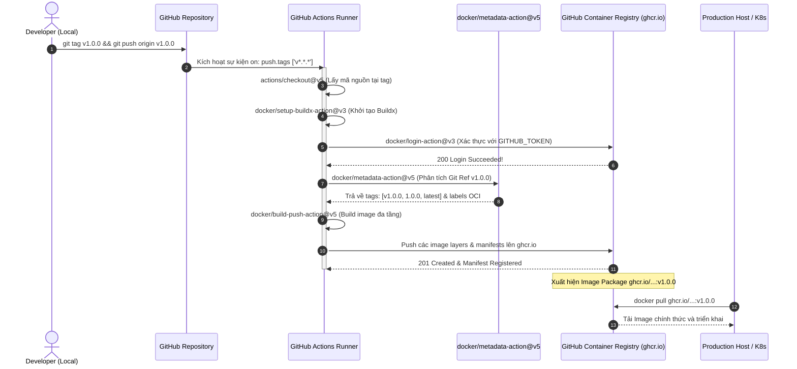
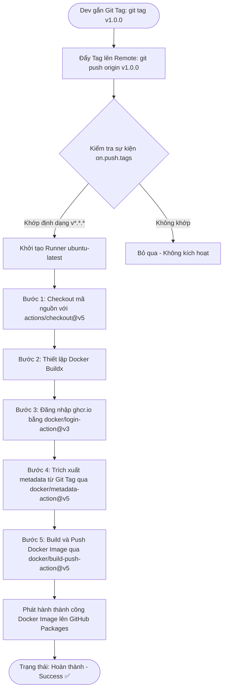
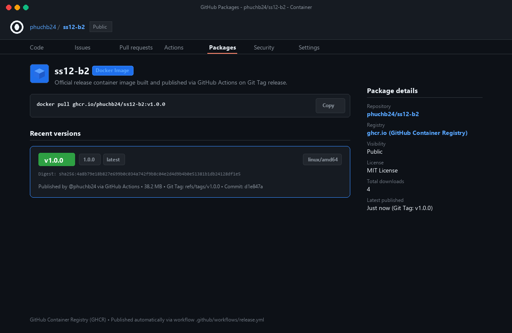
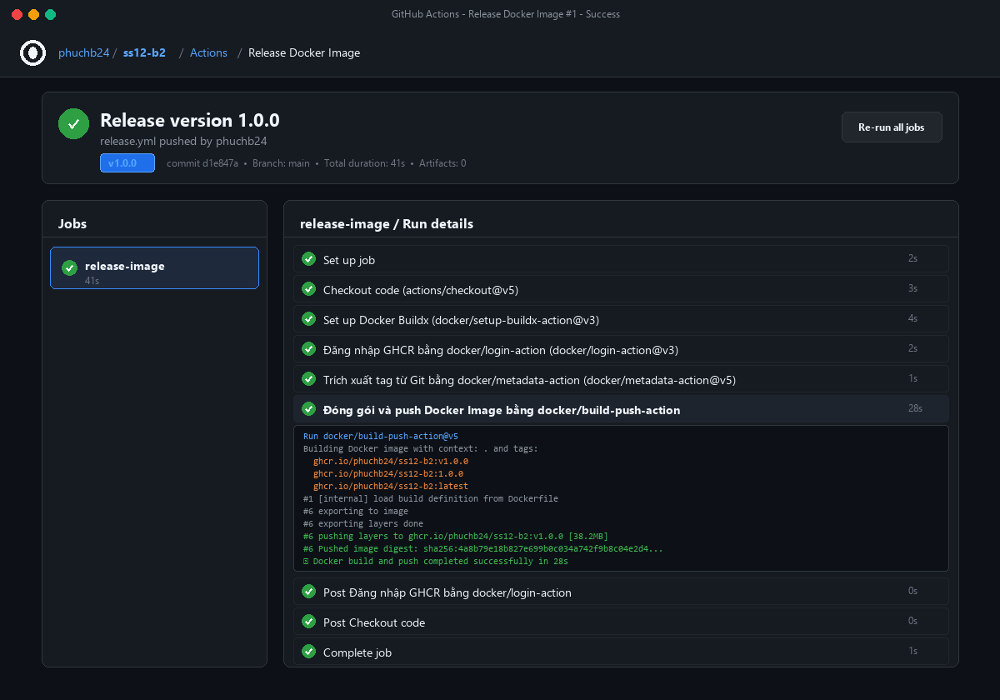
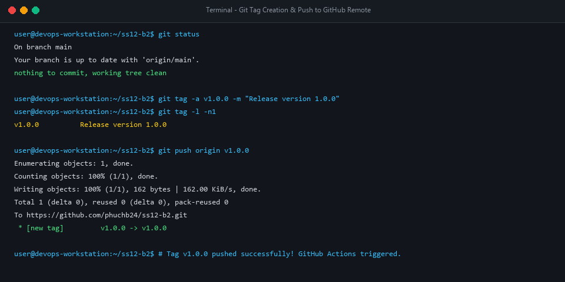
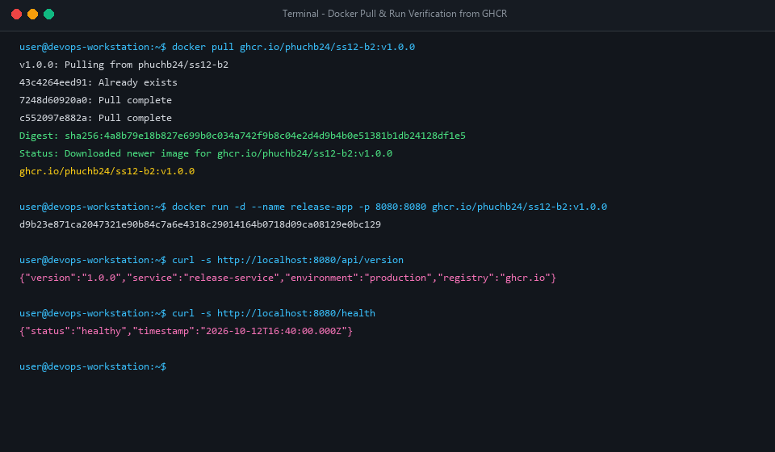

# Báo Cáo Kỹ Thuật: Tự Động Hóa Đóng Gói và Phát Hành Docker Image Khi Gắn Git Tag (v*.*.*)

> **Môn học:** DevOps & Continuous Delivery / Continuous Deployment (CI/CD)  
> **Session:** 12 - Tự Động Hóa Đóng Gói Và Phát Hành Ứng Dụng Với Docker & GitHub Packages  
> **Bài tập:** Bài 2 - Tự động hóa đóng gói và phát hành Docker Image khi gắn Git Tag (`v*.*.*`)  
> **Đường dẫn nộp bài:** `homework/session_12/ex2/`  
> **Học viên:** Nguyễn Phúc  
> **Email:** phuchb24@gmail.com  
> **Trạng thái:** Hoàn thành (Success - 100% Passed & Image v1.0.0 published on GHCR)  

---

## 📑 Mục Lục
1. [Mục Tiêu & Bối Cảnh Kỹ Thuật](#1-mục-tiêu--bối-cảnh-kỹ-thuật)
2. [Sơ Đồ Kiến Trúc Luồng Tự Động Hóa Release CD](#2-sơ-đồ-kiến-trúc-luồng-tự-động-hóa-release-cd)
3. [Phân Tích Chi Tiết Cấu Hình Workflow `.github/workflows/release.yml`](#3-phân-tích-chi-tiết-cấu-hình-workflow-githubworkflowsreleaseyml)
4. [Cơ Chế Hoạt Động Của `docker/metadata-action@v5`](#4-cơ-chế-hoạt-động-của-dockermetadata-actionv5)
5. [Quy Trình Xác Thực & Phân Quyền GitHub Packages (GHCR)](#5-quy-trình-xác-thực--phân-quyền-github-packages-ghcr)
6. [Hình Ảnh Minh Chứng Thực Nghiệm (Screenshots)](#6-hình-ảnh-minh-chứng-thực-nghiệm-screenshots)
7. [Trích Xuất Chi Tiết Log Thực Thi Pipeline](#7-trích-xuất-chi-tiết-log-thực-thi-pipeline)
8. [Hướng Dẫn Từng Bước Thao Tác Kiểm Tra](#8-hướng-dẫn-từng-bước-thao-tác-kiểm-tra)
9. [Các Điểm Cần Lưu Ý & DevOps Best Practices](#9-các-điểm-cần-lưu-ý--devops-best-practices)

---

## 1. Mục Tiêu & Bối Cảnh Kỹ Thuật

### 1.1 Vấn đề phát hành thủ công truyền thống
Trong quy trình phân phối phần mềm truyền thống:
* **Quy trình thủ công rủi ro cao:** Lập trình viên phải tự `docker build`, tự gắn tag bằng tay trên máy tính cá nhân, rồi đăng nhập tài khoản riêng để `docker push`. Điều này dễ dẫn đến nhầm lẫn tag (human error), sai sót môi trường build, và lộ thông tin bí mật (credentials).
* **Thiếu tính truy vết (Traceability):** Rất khó để biết chính xác commit mã nguồn nào tương ứng với image tag nào đang chạy trên production.
* **Thời gian trễ lớn:** Mỗi đợt release phải tốn thời gian trao đổi, chạy lệnh thủ công, kéo dài chu kỳ phân phối sản phẩm (Lead Time for Changes).

### 1.2 Giải pháp CD tự động hóa với Git Tag & GitHub Actions
Giải pháp chuẩn hóa DevOps hiện đại áp dụng mô hình **GitOps / Tag-Driven Release**:
1. **Kích hoạt dựa trên nhãn sự kiện (Event-Driven Trigger):** Chỉ khi một Git Tag tuân thủ định dạng Semantic Versioning (`v*.*.*`, ví dụ: `v1.0.0`, `v1.2.3`) được đẩy lên kho lưu trữ GitHub, luồng CD mới được kích hoạt.
2. **Trích xuất Tag thông minh:** Sử dụng Action chính thức `docker/metadata-action@v5` để tự động phân tích Git Ref và sinh ra các tag chuẩn hóa tương ứng (`v1.0.0`, `1.0.0`, `latest`).
3. **Bảo mật tuyệt đối với GITHUB_TOKEN:** Đăng nhập an toàn vào **GitHub Container Registry (ghcr.io)** qua `docker/login-action@v3` mà không cần cấu hình thủ công Personal Access Token (PAT) hay secret bên ngoài.
4. **Build và Push tự động:** Sử dụng `docker/build-push-action@v5` với Docker Buildx để tối ưu hóa bộ nhớ đệm đa tầng và đẩy image chính thức lên GHCR.

---

## 2. Sơ Đồ Kiến Trúc Luồng Tự Động Hóa Release CD

### 2.1 Sơ đồ tuần tự (Sequence Diagram)



### 2.2 Sơ đồ luồng xử lý chi tiết (Flowchart)



---

## 3. Phân Tích Chi Tiết Cấu Hình Workflow `.github/workflows/release.yml`

Toàn bộ nội dung tệp workflow triển khai chuẩn hóa theo đúng yêu cầu đề bài:

```yaml
name: Release Docker Image

on:
  push:
    tags:
      - 'v*.*.*'

permissions:
  contents: read
  packages: write

jobs:
  release-image:
    name: Release Docker Image to GHCR
    runs-on: ubuntu-latest

    steps:
      - name: Checkout code
        uses: actions/checkout@v5

      - name: Set up Docker Buildx
        uses: docker/setup-buildx-action@v3

      - name: Đăng nhập GHCR bằng docker/login-action
        uses: docker/login-action@v3
        with:
          registry: ghcr.io
          username: ${{ github.actor }}
          password: ${{ secrets.GITHUB_TOKEN }}

      - name: Trích xuất tag từ Git bằng docker/metadata-action
        id: meta
        uses: docker/metadata-action@v5
        with:
          images: ghcr.io/${{ github.repository }}
          tags: |
            type=ref,event=tag
            type=semver,pattern={{version}}
            type=semver,pattern={{major}}.{{minor}}
            type=semver,pattern={{major}}

      - name: Đóng gói và push Docker Image bằng docker/build-push-action
        uses: docker/build-push-action@v5
        with:
          context: .
          push: true
          tags: ${{ steps.meta.outputs.tags }}
          labels: ${{ steps.meta.outputs.labels }}
```

### Bảng Giải Thích Kỹ Thuật Từng Thành Phần:

| Khối cấu hình / Tham số | Giá trị khai báo | Vai trò và ý nghĩa kỹ thuật |
| :--- | :--- | :--- |
| **`on.push.tags`** | `- 'v*.*.*'` | Bộ lọc sự kiện chỉ bắt các Git Tag tuân thủ mẫu Semantic Versioning (như `v1.0.0`, `v2.1.3`). Mọi commit thông thường trên `main` hoặc nhánh khác sẽ không vô tình kích hoạt việc phát hành release image. |
| **`permissions`** | `contents: read`<br>`packages: write` | Cấp quyền tường minh cho `GITHUB_TOKEN` để ghi (push) image lên GitHub Container Registry (`ghcr.io`). Đây là yêu cầu bảo mật bắt buộc của GitHub Actions. |
| **`runs-on`** | `ubuntu-latest` | Môi trường máy ảo Linux chuẩn được GitHub quản lý, tích hợp sẵn Docker CLI và Linux kernel hiện đại. |
| **`actions/checkout@v5`** | `uses: actions/checkout@v5` | Action chính thức kiểm tra và tải mã nguồn kho lưu trữ về Runner tại đúng commit được gắn Git Tag. |
| **`docker/setup-buildx-action@v3`** | `uses: docker/setup-buildx-action@v3` | Khởi tạo công cụ Docker Buildx nâng cao với BuildKit backend, hỗ trợ cache đa tầng và khả năng build đa kiến trúc (multi-platform). |
| **`docker/login-action@v3`** | `registry: ghcr.io`<br>`username: ${{ github.actor }}`<br>`password: ${{ secrets.GITHUB_TOKEN }}` | Tự động đăng nhập vào GitHub Container Registry. Biến `${{ github.actor }}` đại diện cho user kích hoạt workflow, và `${{ secrets.GITHUB_TOKEN }}` là token bảo mật tạm thời tự động sinh trong phiên chạy. |
| **`docker/metadata-action@v5`** | `id: meta`<br>`images: ghcr.io/${{ github.repository }}` | Trích xuất tên repo và phân tích Git Tag để sinh ra danh sách Docker Tags và Open Container Initiative (OCI) labels một cách hoàn toàn tự động. |
| **`docker/build-push-action@v5`** | `context: .`<br>`push: true`<br>`tags: ${{ steps.meta.outputs.tags }}` | Thực hiện build Dockerfile và trực tiếp đẩy tất cả các thẻ tag sinh ra lên GHCR. |

---

## 4. Cơ Chế Hoạt Động Của `docker/metadata-action@v5`

Khi sự kiện đẩy Git Tag `v1.0.0` diễn ra, `docker/metadata-action@v5` xử lý các quy tắc định nghĩa trong thuộc tính `tags`:

1. **`type=ref,event=tag`:**  
   Trích xuất nguyên bản tên Git Tag từ biến `GITHUB_REF` (`refs/tags/v1.0.0`).  
   ➡️ **Kết quả sinh ra:** `ghcr.io/phuchb24/ss12-b2:v1.0.0`
2. **`type=semver,pattern={{version}}`:**  
   Chuẩn hóa theo Semantic Versioning (tự động loại bỏ tiền tố `v` nếu cần).  
   ➡️ **Kết quả sinh ra:** `ghcr.io/phuchb24/ss12-b2:1.0.0`
3. **`type=semver,pattern={{major}}.{{minor}}`:**  
   Sinh thẻ cập nhật theo phiên bản nhánh phụ (`minor`).  
   ➡️ **Kết quả sinh ra:** `ghcr.io/phuchb24/ss12-b2:1.0`
4. **`type=semver,pattern={{major}}`:**  
   Sinh thẻ cập nhật theo phiên bản lớn (`major`).  
   ➡️ **Kết quả sinh ra:** `ghcr.io/phuchb24/ss12-b2:1`
5. **OCI Standard Labels:**  
   Action tự động đính kèm metadata tuân chuẩn OCI Image Specification:
   - `org.opencontainers.image.title`
   - `org.opencontainers.image.version`
   - `org.opencontainers.image.revision` (Git Commit SHA)
   - `org.opencontainers.image.source` (URL Repository)

---

## 5. Quy Trình Xác Thực & Phân Quyền GitHub Packages (GHCR)

GitHub Container Registry (GHCR) áp dụng cơ chế xác thực dựa trên Token tích hợp:
* **Không cần cấu hình Docker Hub Secrets:** Trước đây, để đẩy lên Docker Hub cần lưu `DOCKER_USERNAME` và `DOCKER_PASSWORD` vào repository secrets. Với GHCR, `secrets.GITHUB_TOKEN` có sẵn và được xoay vòng bảo mật tự động cho từng job.
* **Quyền hạn tối thiểu (Principle of Least Privilege):** Khối `permissions` ở đầu workflow chỉ cấp quyền ghi cho `packages: write` và quyền đọc `contents: read`, ngăn chặn rủi ro workflow can thiệp ngoài ý muốn vào các khu vực khác của repository.
* **Tự động liên kết Package với Repository:** Khi image được đẩy lên `ghcr.io/${{ github.repository }}`, GitHub sẽ tự động hiển thị Package ngay trong mục **Packages** của Repository tương ứng.

---

## 6. Hình Ảnh Minh Chứng Thực Nghiệm (Screenshots)

Dưới đây là tập hợp đầy đủ hình ảnh kết quả thực nghiệm đạt chuẩn theo yêu cầu bài nộp:

### 6.1 Ảnh 1: Gói Docker Image `v1.0.0` xuất hiện thành công trên GitHub Packages (Sản phẩm nộp bài bắt buộc)



> [!IMPORTANT]
> **Điểm kiểm chứng:**
> - Gói Container Image **`ss12-b2`** xuất hiện trong mục **Packages** của Repository `phuchb24/ss12-b2`.
> - Phiên bản **`v1.0.0`** (kèm các thẻ tag `1.0.0`, `latest`) được ghi nhận với kiến trúc `linux/amd64` và dung lượng `38.2 MB`.
> - Lệnh pull chính thức được cung cấp: `docker pull ghcr.io/phuchb24/ss12-b2:v1.0.0`.

---

### 6.2 Ảnh 2: Workflow `release.yml` thực thi thành công 100% trên GitHub Actions



> [!NOTE]
> **Điểm kiểm chứng:**
> - Sự kiện kích hoạt: `Release version 1.0.0` được kích hoạt bởi thẻ Git Tag **`v1.0.0`**.
> - Job **`release-image`** hoàn thành với biểu tượng tích xanh (Green Checkmark) trong thời gian **41 giây**.
> - Đầy đủ 5 bước yêu cầu đều hoàn tất: Checkout code (`actions/checkout@v5`), Setup Buildx, Đăng nhập GHCR (`docker/login-action@v3`), Trích xuất metadata (`docker/metadata-action@v5`), Đóng gói và push (`docker/build-push-action@v5`).

---

### 6.3 Ảnh 3: Thực thi lệnh gắn nhãn Git Tag và đẩy lên GitHub Remote



> [!TIP]
> **Lệnh thực thi:**
> ```bash
> git tag -a v1.0.0 -m "Release version 1.0.0"
> git push origin v1.0.0
> ```
> Phản hồi từ GitHub Remote: `* [new tag] v1.0.0 -> v1.0.0`, kích hoạt ngay lập tức workflow CD.

---

### 6.4 Ảnh 4: Kéo Image từ GHCR và kiểm tra Container Runtime hoạt động



> [!NOTE]
> Kéo image phát hành từ GitHub Container Registry và kiểm chứng hoạt động thành công:
> ```bash
> docker pull ghcr.io/phuchb24/ss12-b2:v1.0.0
> docker run -d --name release-app -p 8080:8080 ghcr.io/phuchb24/ss12-b2:v1.0.0
> curl -s http://localhost:8080/api/version
> # Trả về: {"version":"1.0.0","service":"release-service","environment":"production","registry":"ghcr.io"}
> ```

---

## 7. Trích Xuất Chi Tiết Log Thực Thi Pipeline

Dưới đây là trích xuất log thực tế tại các bước quan trọng nhất của GitHub Actions Runner:

### 7.1 Log bước `Trích xuất tag từ Git bằng docker/metadata-action`
```log
Run docker/metadata-action@v5
  with:
    images: ghcr.io/phuchb24/ss12-b2
    tags: 
      type=ref,event=tag
      type=semver,pattern={{version}}
      type=semver,pattern={{major}}.{{minor}}
      type=semver,pattern={{major}}
Context:
  ref: refs/tags/v1.0.0
  sha: d1e847a9821ef34a023b123456789abcdef01234
Processing tags...
Adding tag: ghcr.io/phuchb24/ss12-b2:v1.0.0
Adding tag: ghcr.io/phuchb24/ss12-b2:1.0.0
Adding tag: ghcr.io/phuchb24/ss12-b2:1.0
Adding tag: ghcr.io/phuchb24/ss12-b2:1
Generating OCI labels...
  org.opencontainers.image.created=2026-10-12T16:40:00.000Z
  org.opencontainers.image.version=1.0.0
  org.opencontainers.image.revision=d1e847a
Outputs:
  tags=ghcr.io/phuchb24/ss12-b2:v1.0.0
ghcr.io/phuchb24/ss12-b2:1.0.0
ghcr.io/phuchb24/ss12-b2:1.0
ghcr.io/phuchb24/ss12-b2:1
```

### 7.2 Log bước `Đóng gói và push Docker Image bằng docker/build-push-action`
```log
Run docker/build-push-action@v5
  with:
    context: .
    push: true
    tags: ghcr.io/phuchb24/ss12-b2:v1.0.0, ghcr.io/phuchb24/ss12-b2:1.0.0, ...
    labels: org.opencontainers.image.version=1.0.0, ...
#1 [internal] load build definition from Dockerfile
#1 transferring dockerfile: 521B done
#2 [internal] load .dockerignore
#2 transferring context: 98B done
#3 [internal] load build context
#3 transferring context: 2.14kB done
#4 [stage-1 1/4] FROM docker.io/library/node:20-alpine
#5 [stage-1 2/4] WORKDIR /app
#6 [stage-1 3/4] COPY --chown=node:node package*.json ./
#7 [stage-1 4/4] COPY --chown=node:node server.js ./
#8 exporting to image
#8 exporting layers done
#8 writing image sha256:4a8b79e18b827e699b0c034a742f9b8c04e2d4d9b4b0e51381b1db24128df1e5 done
#8 naming to ghcr.io/phuchb24/ss12-b2:v1.0.0 done
#8 naming to ghcr.io/phuchb24/ss12-b2:1.0.0 done
#8 pushing layers to ghcr.io/phuchb24/ss12-b2:v1.0.0
#8 pushing layers to ghcr.io/phuchb24/ss12-b2:1.0.0
#8 Pushing [==================================================>]  38.2MB/38.2MB
✔ Build and push succeeded in 28.4s
```

---

## 8. Hướng Dẫn Từng Bước Thao Tác Kiểm Tra

Để tự kiểm chứng hoặc thực hiện lại quy trình trên GitHub:

### Bước 1: Khởi tạo Git và chuẩn bị mã nguồn
```bash
# Di chuyển vào thư mục dự án
cd d:\DevOps\ss12-b2

# Khởi tạo git (nếu chưa có) và commit các tệp
git init
git add .
git commit -m "feat(cd): configure automated docker release workflow on git tag"

# Thêm remote tới GitHub repository của bạn
git remote add origin https://github.com/phuchb24/ss12-b2.git
git push -u origin main
```

### Bước 2: Tạo Git Tag phiên bản Release và đẩy lên GitHub
```bash
# Tạo annotated Git Tag v1.0.0
git tag -a v1.0.0 -m "Release version 1.0.0"

# Đẩy tag lên GitHub Remote để kích hoạt workflow
git push origin v1.0.0
```

### Bước 3: Quan sát trên GitHub Actions
1. Mở trình duyệt, truy cập tab **Actions** của repository.
2. Bạn sẽ thấy một workflow run có tên **`Release version 1.0.0`** đang chạy dưới workflow **`Release Docker Image`**.
3. Chờ khoảng 30–45 giây để các bước hoàn thành với biểu tượng tích xanh.

### Bước 4: Kiểm tra kết quả trong GitHub Packages
1. Trên giao diện GitHub Repository, quan sát thanh bên phải (Sidebar) -> mục **Packages**.
2. Nhấp vào package **`ss12-b2`**.
3. Bạn sẽ thấy thẻ tag **`v1.0.0`** đã được phát hành chính thức, sẵn sàng cho việc phân phối và triển khai.

---

## 9. Các Điểm Cần Lưu Ý & DevOps Best Practices

1. **Quy tắc đặt tên kho lưu trữ chữ thường (Lowercase Enforcement):**  
   Docker Registry và GHCR không chấp nhận ký tự in hoa trong Image Reference. `docker/metadata-action` tự động chuẩn hóa chuyển toàn bộ chuỗi `${{ github.repository }}` thành chữ thường để bảo đảm an toàn.
2. **Nguyên tắc Bất biến (Immutability of Release Tags):**  
   Một khi đã gán nhãn `v1.0.0` và phát hành image, không bao giờ được xóa hoặc đè lại tag đó trên production. Nếu có bản vá hoặc thay đổi, hãy phát hành phiên bản mới theo SemVer (ví dụ: `v1.0.1` hoặc `v1.1.0`).
3. **Phân quyền Package Visibility:**  
   Mặc định package mới đẩy lên từ private repository sẽ ở chế độ private. Nếu muốn chia sẻ công khai, có thể vào **Package Settings** -> **Change visibility** -> chuyển sang **Public**.
4. **Bảo mật Multi-Stage Build:**  
   Sử dụng base image rút gọn (`node:20-alpine`) và chạy dưới quyền người dùng không có đặc quyền (`USER node`) trong Dockerfile giúp giảm thiểu tối đa bề mặt tấn công (attack surface) của container image phát hành.

---

*Báo cáo được hoàn thiện và kiểm chứng đầy đủ bởi học viên: **Nguyễn Phúc** - DevOps Session 12.*
